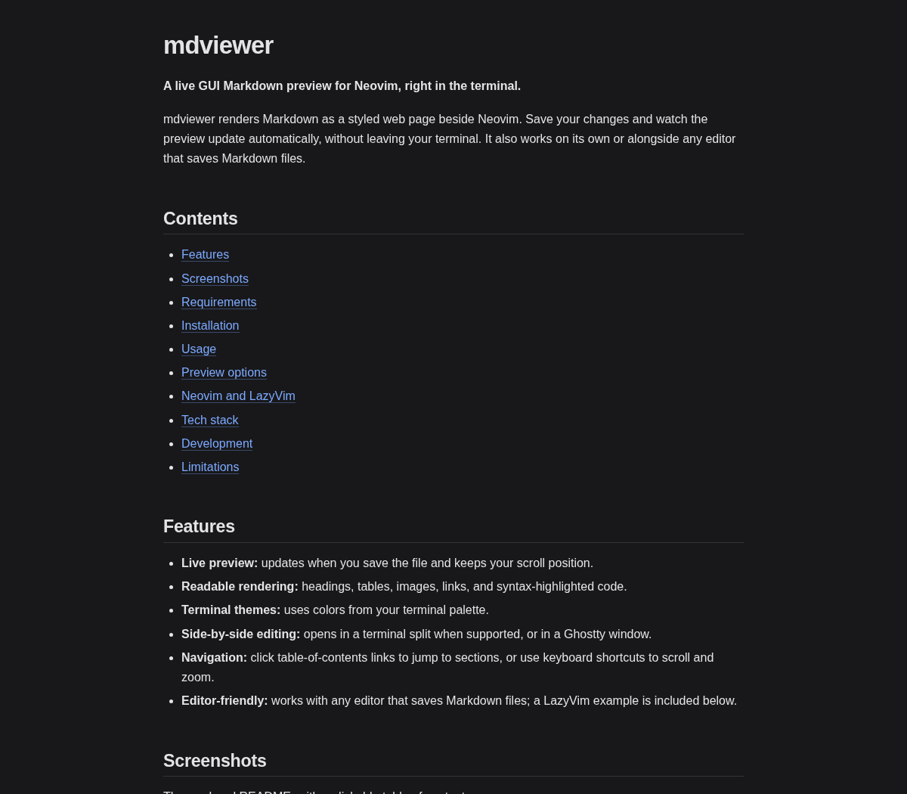
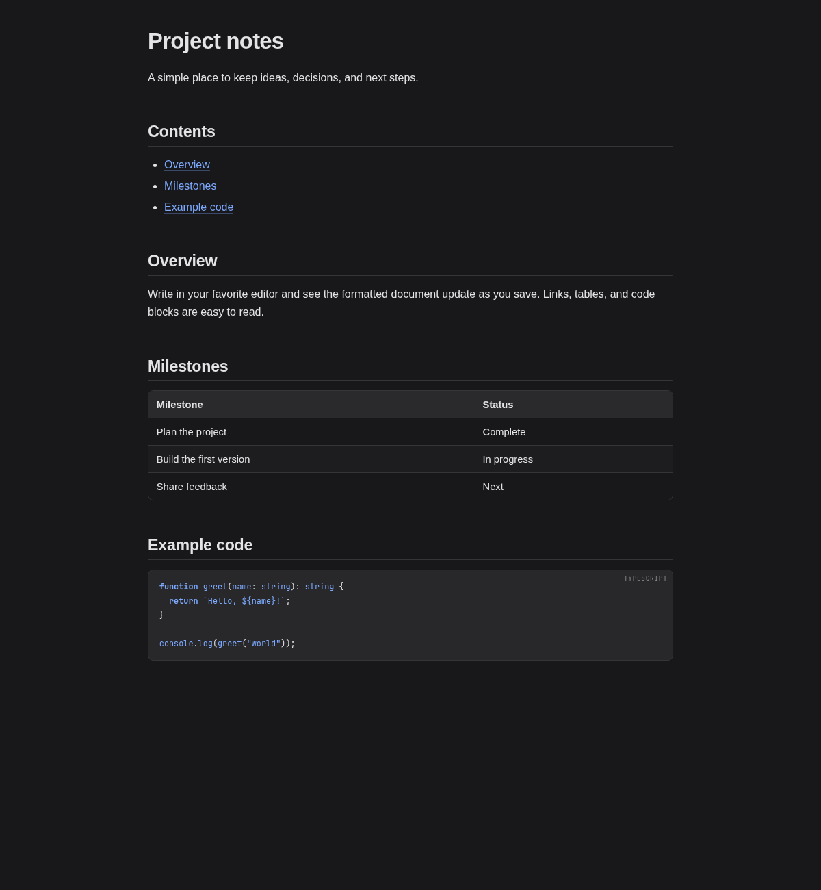

# mdviewer

**A live GUI Markdown preview for Neovim, right in the terminal.**

mdviewer renders Markdown as a styled web page beside Neovim. Save your changes and watch the preview update automatically, without leaving your terminal. It also works on its own or alongside any editor that saves Markdown files.

## Contents

- [Features](#features)
- [Screenshots](#screenshots)
- [Requirements](#requirements)
- [Installation](#installation)
- [Usage](#usage)
- [Preview options](#preview-options)
- [Neovim and LazyVim](#neovim-and-lazyvim)
- [Tech stack](#tech-stack)
- [Development](#development)
- [Limitations](#limitations)

## Features

- **Live preview:** updates when you save the file and keeps your scroll position.
- **Readable rendering:** headings, tables, images, links, and syntax-highlighted code.
- **Terminal themes:** uses colors from your terminal palette.
- **Side-by-side editing:** opens in a terminal split when supported, or in a Ghostty window.
- **Navigation:** click table-of-contents links to jump to sections, or use keyboard shortcuts to scroll and zoom.
- **Editor-friendly:** works with any editor that saves Markdown files; a LazyVim example is included below.

## Screenshots

The rendered README, with a clickable table of contents:



An example document with a table and syntax-highlighted code:



These images show the rendered document area; the terminal preview also has a header with the file name and shortcuts.

## Requirements

- Linux or macOS and Node.js 20 or newer.
- A terminal with [kitty graphics protocol](https://sw.kovidgoyal.net/kitty/graphics-protocol/) support, such as Ghostty, kitty, WezTerm, iTerm2, Konsole, or Warp.
- A compatible terminal or multiplexer for opening splits. If a split is unavailable, mdviewer opens in the current pane. Multiplexers such as herdr and tmux may be slower.

## Installation

Clone the repository, install its dependencies, and build it:

```sh
git clone https://github.com/rigofekete/mdview.git mdviewer
cd mdviewer
npm install
npm run build
```

The repository is called **mdviewer** in this guide. The executable is currently named `mdview.mjs`; no global install is required. Installing dependencies downloads Pixel's patched Electron runtime.

## Usage

Run these commands from the repository directory:

```sh
# Open a Markdown file beside your current terminal pane
bin/mdview.mjs open path/to/document.md

# Choose a split direction and size
bin/mdview.mjs open README.md --split down --size 40

# Open in the current pane instead
bin/mdview.mjs README.md --here
```

Use `bin/mdview.mjs --help` to see the available options. Save the Markdown file in your editor to refresh the preview.

### Keyboard shortcuts

| Key | Action |
| --- | --- |
| `q`, `esc` | Quit the preview |
| `r` | Reload the file |
| `j` / `k` | Scroll down / up |
| `d` / `u` | Scroll down / up by a page |
| `g` / `G` | Go to the top / bottom |
| `+` / `-` / `0` | Zoom in / out / reset |
| `backspace` | Go back after following a link |

## Preview options

By default, mdviewer tries to open a split. When running inside herdr with Ghostty available, it opens a native Ghostty window instead. If a split is not available, it falls back to the current pane.

```sh
# Force a Ghostty window
bin/mdview.mjs open README.md --terminal ghostty

# Force a terminal split, including inside herdr
bin/mdview.mjs open README.md --terminal herdr

# Always use the current pane
bin/mdview.mjs open README.md --here
```

You can set the target with a flag, an environment variable, or a config file:

| Method | Example |
| --- | --- |
| Flag | `--terminal herdr` |
| Environment | `MDVIEW_TERMINAL=herdr` |
| Config | `~/.config/mdview/config.json`: `{"terminal": "herdr"}` |

Supported values are `auto`, `ghostty`, and `herdr`. The flag takes precedence over the environment variable, which takes precedence over the config file. The config path respects `$XDG_CONFIG_HOME`. A forced Ghostty window requires Ghostty and a graphical session.

## Neovim and LazyVim

This LazyVim example opens the current file with `<leader>mp`. Add it to `~/.config/nvim/lua/plugins/mdview.lua` and adjust the path to your clone:

```lua
return {
  {
    "LazyVim/LazyVim",
    keys = {
      {
        "<leader>mp",
        function()
          local file = vim.api.nvim_buf_get_name(0)
          if file == "" or vim.fn.filereadable(file) == 0 then
            return vim.notify("mdview: buffer is not a file on disk", vim.log.levels.WARN)
          end
          local bin = vim.env.MDVIEW_BIN or (vim.fn.expand("~") .. "/mdviewer/bin/mdview.mjs")
          vim.fn.jobstart({ bin, "open", file, "--split", "right" }, { detach = true })
        end,
        desc = "Markdown preview (mdviewer)",
      },
    },
  },
}
```

Restart Neovim after adding the file. You can also set `MDVIEW_BIN` to the full path of `bin/mdview.mjs` instead of changing the example.

## Tech stack

| Technology | Purpose |
| --- | --- |
| TypeScript, React, and Node.js | Application and command-line launcher |
| [Pixel](https://github.com/zenbu-labs/terminal-browser/tree/main/pixel) | Terminal UI, splits, and embedded web view |
| Electron and Chromium | Render the preview as a web page |
| [markdown-it](https://github.com/markdown-it/markdown-it) | Convert Markdown to HTML |
| [highlight.js](https://highlightjs.org/) | Highlight fenced code blocks |
| Kitty graphics protocol | Display the rendered page in the terminal |

mdviewer converts the file to HTML, applies colors from the terminal, and displays it in a Chromium web view. It checks the file for changes and reloads the preview when needed.

## Development

```sh
npm run build       # Compile TypeScript into dist/
npm run typecheck   # Check types without building
npm test            # Run navigation tests (requires Chromium)
```

To capture a preview for debugging, pass the capture options after `--`:

```sh
bin/mdview.mjs --here README.md -- --shot /tmp/mdview.png --quit-after 9000
```

Pixel writes application errors to `~/.local/state/pixel/logs/mdview.stderr.log`.

## Limitations

- Each preview runs a Chromium renderer, which can use a few hundred MB of memory.
- External links open inside the preview, not in your system browser. Press `backspace` to return.
- There is no search, file picker, export, or per-file pane reuse yet.
- This is a previewer, not an editor.
