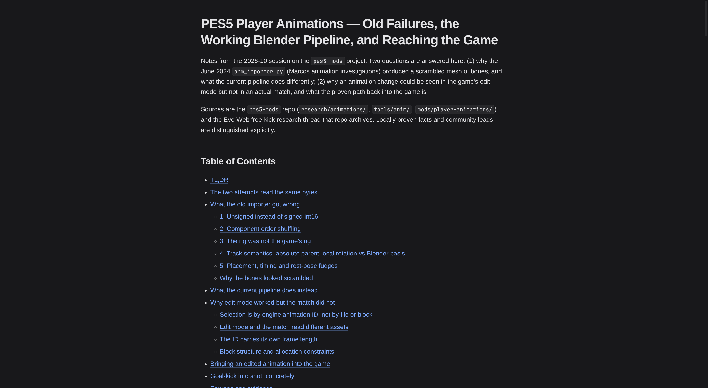

# mdview

Render a Markdown file as a real web page **inside the terminal** with [Pixel](https://github.com/zenbu-labs/terminal-browser/tree/main/pixel), and open it next to Neovim with one keypress.

## Table of Contents

- [Features](#features)
- [Requirements](#requirements)
- [Install](#install)
- [Usage](#usage)
- [Preview target](#preview-target)
- [LazyVim](#lazyvim)
- [How it works](#how-it-works)
- [Development](#development)
- [Limitations](#limitations)



```
┌─ nvim ─────────────────┬─ mdview ──────────────────────────┐
│ # PES5 Player …        │ md  animations.md  312 lines …    │
│                        │ ─────────────────────────────────  │
│                        │  PES5 Player Animations — Old      │
│                        │  Failures, the Working Blender …   │
└────────────────────────┴───────────────────────────────────┘
```

Pixel draws real pixels through the [kitty graphics protocol](https://sw.kovidgoyal.net/kitty/graphics-protocol/), so the page is rendered by Chromium — full CSS, tables, syntax highlighting — while living in a terminal pane instead of a separate window.

---

## Features

- Markdown → HTML with `markdown-it` (GFM tables, task lists, autolinks, code fences) and `highlight.js` for fenced code.
- Terminal-native theme: colours are derived from the terminal palette, so the page follows your Ghostty/herdr theme.
- Native Pixel header bar (file name, line/word count, key hints) composed above the Chromium `WebView`.
- Live preview: polls the file and reloads in place, preserving scroll position, so edits in Neovim show up without switching panes.
- Opens in a split via Pixel's terminal API — herdr, tmux, Ghostty, kitty, WezTerm and the other backends Pixel supports — or in a native Ghostty window when launched from herdr; falls back to the current pane.

---

## Requirements

- Linux or macOS, Node 20+.
- A terminal with kitty-graphics support (Ghostty, kitty, WezTerm, iTerm2, Konsole, Warp, …). Multiplexers (herdr, tmux) work with reduced performance.

---

## Install

```sh
git clone <this repo> ~/Work/dev/mdview
cd ~/Work/dev/mdview
npm install          # downloads the patched Electron runtime
npm run build
```

---

## Usage

```sh
# open in a new pane to the right of the current one
bin/mdview.mjs open ~/Work/notes/mods/pes5/animations.md --split right

# other split directions / sizes
bin/mdview.mjs open README.md --split down --size 40

# open in the current pane
bin/mdview.mjs README.md --here

# force a native Ghostty window (errors if Ghostty is unavailable)
bin/mdview.mjs open README.md --terminal ghostty

# force the current pane split, even inside herdr
bin/mdview.mjs open README.md --terminal herdr
```

Keys inside the preview:

| Key | Action |
| --- | --- |
| `q`, `esc` | quit and close the pane |
| `r` | re-render from disk |
| `j` / `k` | scroll down / up |
| `d` / `u` | scroll a page |
| `g` / `G` | top / bottom |
| `+` / `-` / `0` | zoom in / out / reset |
| `backspace` | back (after following an external link) |

---

## Preview target

`mdview open` chooses where the preview runs:

| `--terminal` | Behavior |
| --- | --- |
| `auto` (default) | Inside herdr, open a native Ghostty window when `ghostty` is installed and `WAYLAND_DISPLAY`/`DISPLAY` is set. Otherwise split the current pane. |
| `ghostty` | Force a native Ghostty window. Exits non-zero with a clear message if Ghostty or a graphical session is missing. |
| `herdr` | Force the current pane split (the original behavior), even when a Ghostty window is available. |

Flags beat environment, environment beats the config file:

1. `--terminal ...`
2. `MDVIEW_TERMINAL=ghostty`
3. `$XDG_CONFIG_HOME/mdview/config.json` (defaults to `~/.config/mdview/config.json`)
4. `auto`

To switch back to the integrated pane permanently, change one value:

```json
{"terminal": "herdr"}
```

Or for a single invocation, use `--terminal herdr` (or `MDVIEW_TERMINAL=herdr`). The same precedence applies to the LazyVim job, so no plugin edit is needed when you change your mind.

### Why a window instead of a pane?

Inside herdr, Pixel used a private pane-graphics API. herdr 0.9.2 removed it, so Pixel falls back to sending complete frames through the pty: every scroll frame is a pane-sized image that herdr parses, forwards and re-encodes. An active preview measured ~2.3 CPU cores and scrolling was unusable. A native Ghostty window is roughly 5x cheaper per pixel; a static preview idles at ~0% either way.

`auto` only switches when it can help: herdr is present (`HERDR_PANE_ID`), Ghostty is on `PATH` or at `$GHOSTTY_BIN_DIR/ghostty`, and a graphical session exists. The window child gets no `HERDR_*` variables, so Pixel cannot take the herdr path.

### Ghostty 1.3 has no CLI split

Ghostty 1.3 exposes only `+new-window` as a CLI action; `new_split` and `new_tab` are keybind-only. The new window is tiled by the compositor (Hyprland in the measured setup), which is the practical "pane next to herdr".

If you prefer a real Ghostty split, bind one and run mdview inside it:

```ini
# ~/.config/ghostty/config
keybind = ctrl+shift+enter=new_split:right
```

```sh
# in the new split
bin/mdview.mjs ~/Work/notes/mods/pes5/animations.md --here
```

---

## LazyVim

Add `~/.config/nvim/lua/plugins/mdview.lua`:

```lua
return {
  {
    "LazyVim/LazyVim",
    keys = {
      {
        "<leader>mp",
        function()
          local file = vim.api.nvim_buf_get_name(0)
          if file == "" or vim.fn.filereadable(file) == 0 then
            return vim.notify("mdview: buffer is not a file on disk", vim.log.levels.WARN)
          end
          local bin = vim.env.MDVIEW_BIN or (vim.fn.expand("~") .. "/Work/dev/mdview/bin/mdview.mjs")
          vim.fn.jobstart({ bin, "open", file, "--split", "right" }, { detach = true })
        end,
        desc = "Markdown preview (mdview, split)",
      },
    },
  },
}
```

Restart Neovim after adding it. `MDVIEW_BIN` overrides the binary path.

---

## How it works

1. `bin/mdview.mjs` picks a preview target (a native Ghostty window inside herdr by default, otherwise a pane split), then runs `pixel <app dir> -- <file>` there. The pane path detects the hosting terminal and asks for its current pane first.
2. `src/main.tsx` boots a Pixel root, renders a native header bar and a full-size `WebView` pointed at a generated HTML file.
3. `src/render.ts` converts the Markdown, injects CSS variables derived from the terminal palette, and writes the page to `$TMPDIR/mdview/<hash>.html` with a `<base href="file://…">` so relative images resolve.
4. A 350 ms poll re-renders and reloads when the file's mtime/size changes.

---

## Development

```sh
npm run build       # tsc → dist/
npm run typecheck
npm start           # build and run against the current directory

# capture the rendered page to a PNG without looking at the terminal
bin/mdview.mjs --here README.md --shot /tmp/mdview.png --quit-after 9000
```

Pixel reports the app's stderr at `~/.local/state/pixel/logs/mdview.stderr.log`.

---

## Limitations

- A Chromium renderer per preview: a few hundred MB. Pixel's native `Markdown` component is far lighter but cannot match browser CSS.
- External links navigate inside the preview (use `backspace` to go back); there is no hand-off to the system browser yet.
- No search, file picker, export or per-file pane reuse.
- Preview-only: editing happens in Neovim.
